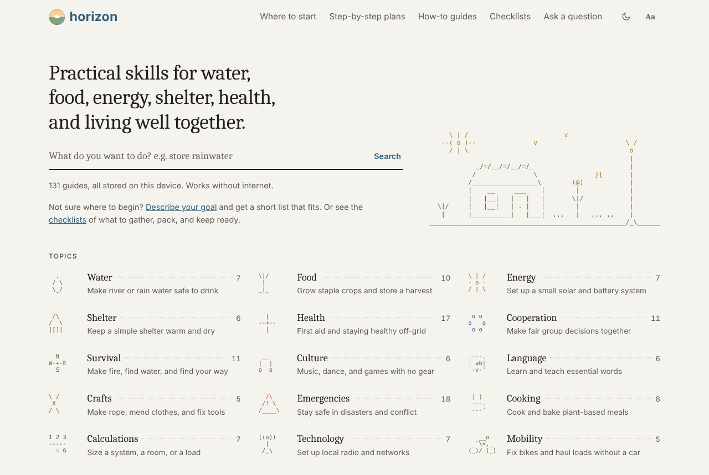
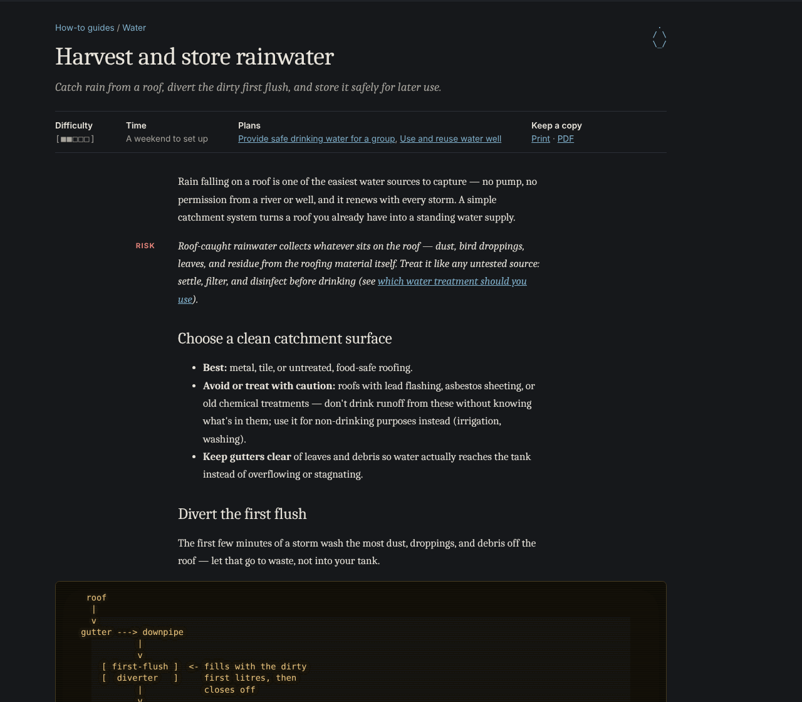
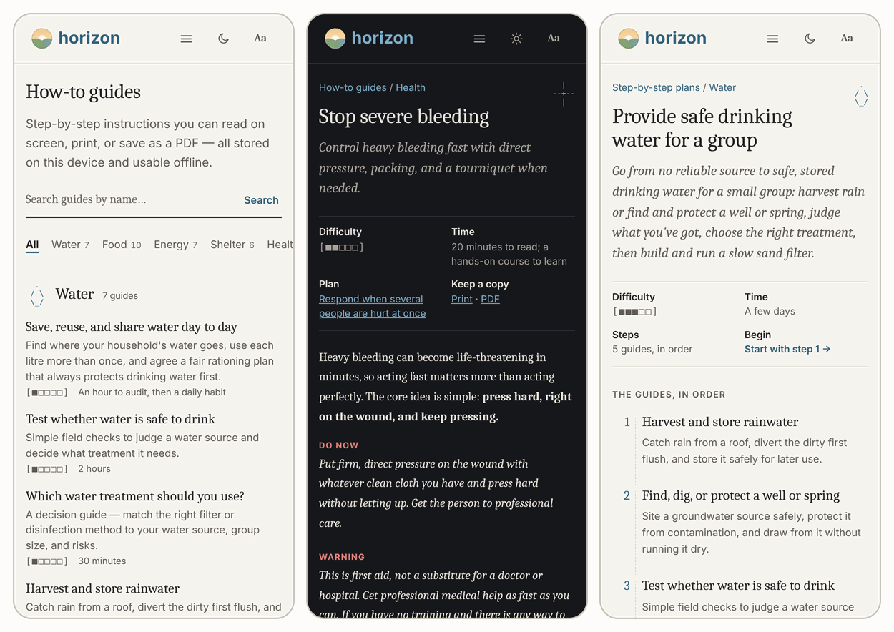

<div align="center">

<picture>
  <source media="(prefers-color-scheme: dark)" srcset="docs/images/logo-dark.svg">
  
</picture>

**An offline-first autonomy node for basic human skills.**

[](CHANGELOG.md)
[](LICENSE)

</div>

horizon is a small server you run on your own hardware — a Raspberry Pi,
mini-PC, or VM. It gives a household or neighbourhood **visual how-to guides**,
**step-by-step plans**, and a **local AI assistant**. Fully offline after setup.

<picture>
  <source media="(prefers-color-scheme: dark)" srcset="docs/images/morning-dark.svg">
  
</picture>

## What you get

- **Visual guides** across 15 topics, drawn with ASCII diagrams that work on any screen or paper.
- **Step-by-step plans** that thread guides into a path.
- **Print-ready** A4 PDFs and tick-able checklists.
- **Offline extras:** a Wikipedia reference library and a map viewer.
- **Local AI assistant** that cites your guides. No cloud. Optional.
- **Made for neighbours:** plain language, phone-friendly, accessible.

<picture>
  <source media="(prefers-color-scheme: dark)" srcset="docs/images/topics-dark.svg">
  
</picture>

→ [All features](docs/features.md)

## Screenshots







## Quickstart

```bash
git clone https://github.com/richardkfm/horizon
cd horizon
docker compose up -d
```

Open **http://&lt;host-ip&gt;:8080** on any device in your network.
No Docker or git? → [Install guide](docs/install.md).

## Configuration

Edit `config.yaml` — it ships with safe, offline defaults.


Admin token, CLI, local AI, content packs → [Operating guide](docs/operating.md).

---

[Install](docs/install.md) · [Features](docs/features.md) ·
[Operating](docs/operating.md) · [Authoring content](docs/authoring-content.md) ·
[API](docs/api.md) · [Changelog](CHANGELOG.md) · [Roadmap](ROADMAP.md)

**Status:** v0.9.5 · [PolyForm Noncommercial 1.0.0](LICENSE): free for
noncommercial use; commercial use needs a separate agreement.
